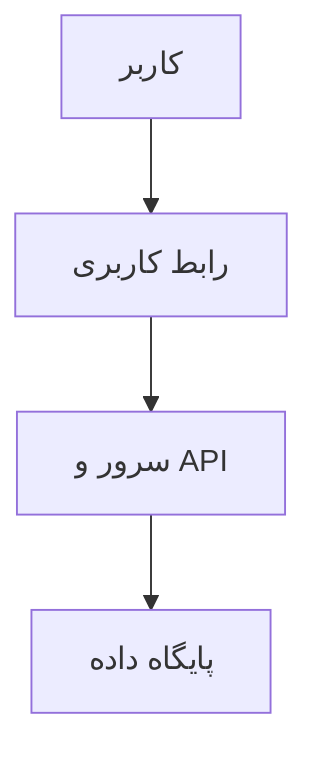

# تبسم وثاق ساعت 13:30 درس مباحث ویژه برنامه نویسی

# سیستم مدیریت وظایف

## ۱. منابع پروژه (Resources)
این پروژه شامل دو منبع اصلی است:
- کاربران (Users): نگهداری اطلاعات کاربران سیستم.
- وظایف (Tasks): نگهداری اطلاعات وظایف هر کاربر.

## ۲. آدرس‌های مربوط به کاربران(Users Endpoints)
| آدرس | متد | کد وضعیت |
|---|---|---|
| /users | GET | 200 |
| /users | POST | 201 |
| /users/{id} | PUT | 200 |
| /users/{id} | DELETE | 204 |

## ۳. آدرس‌های مربوط به وظایف (Tasks Endpoints)
| آدرس | متد | کد وضعیت |
|---|---|---|
| /tasks | GET | 200 |
| /tasks | POST | 201 |
| /tasks/{id} | GET | 200 |
| /tasks/{id} | PUT | 200 |
| /tasks/{id} | DELETE | 204 |
## ۴. دیاگرام معماری (Architecture Diagram)

