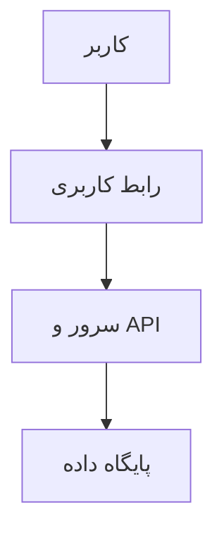
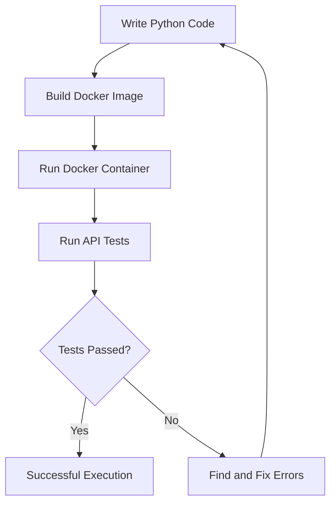

آتنا قربانی 

# فعالیت فصل 3
## سیستم مدیریت وظایف

## ۱. منابع پروژه (Resources)
این پروژه شامل دو منبع اصلی است:
- کاربران (Users): نگهداری اطلاعات کاربران سیستم.
- وظایف (Tasks): نگهداری اطلاعات وظایف هر کاربر.

## ۲. آدرس‌های مربوط به کاربران(Users Endpoints)
| آدرس | متد | کد وضعیت |
|---|---|---|
| /users | GET | 200 |
| /users | POST | 201 |
| /users/{id} | PUT | 200 |
| /users/{id} | DELETE | 204 |

## ۳. آدرس‌های مربوط به وظایف (Tasks Endpoints)
| آدرس | متد | کد وضعیت |
|---|---|---|
| /tasks | GET | 200 |
| /tasks | POST | 201 |
| /tasks/{id} | GET | 200 |
| /tasks/{id} | PUT | 200 |
| /tasks/{id} | DELETE | 204 |
## ۴. دیاگرام معماری (Architecture Diagram)

# فعالیت فصل 4
## Digital Wallet – Dockerized Backend

## معرفی پروژه

در این پروژه یک بک‌اند ساده برای سیستم کیف پول دیجیتال (Digital Wallet) با زبان Python و فریم‌ورک Flask پیاده‌سازی شده است.

این سیستم امکاناتی مثل ثبت‌نام کاربران، ورود به حساب، مشاهده موجودی کیف پول، واریز وجه و انتقال پول بین کاربران را فراهم می‌کند.

برای اجرای برنامه از Docker استفاده شده تا بک‌اند داخل یک Container اجرا شود.

## ابزارهای استفاده‌شده

- Python
- Flask
- SQLite
- Docker
- GitHub Codespaces

## ساختار فایل‌های پروژه

- `app/app.py` : کد اصلی بک‌اند و تعریف APIها
- `requirements.txt` : کتابخانه‌های موردنیاز پروژه
- `Dockerfile` : دستورالعمل ساخت Docker Image
- `.dockerignore` : مشخص کردن فایل‌هایی که نباید وارد Image شوند
- `README.md` : توضیحات پروژه

## ساخت Docker Image

برای ساخت Image از دستور زیر استفاده شده است:

```bash
docker build -t digital-wallet .
```

در این مرحله Docker با استفاده از Dockerfile، محیط اجرای Python را آماده کرده و کتابخانه‌های موردنیاز و فایل‌های بک‌اند را داخل Image قرار می‌دهد.

## اجرای Container

پس از ساخت Image، با دستور زیر Container اجرا می‌شود:

```bash
docker run -d -p 5000:5000 --name wallet-container digital-wallet
```

در این دستور:
- `digital-wallet` نام Image است.
- `wallet-container` نام Container است.
- `-d` باعث اجرای برنامه در پس‌زمینه می‌شود.
- `-p 5000:5000` پورت سیستم را به پورت داخل Container متصل می‌کند.

## بررسی وضعیت Container

برای مشاهده Containerهای در حال اجرا از دستور زیر استفاده می‌شود:

```bash
docker ps
```

## اتصال پورت‌ها (Port Mapping)

پورت 5000 در محیط Codespaces به پورت 5000 داخل Container متصل شده است. این اتصال باعث می‌شود بتوان از طریق مرورگر به API دسترسی داشت.

## تست بک‌اند

برای بررسی اجرای صحیح برنامه، آدرس اصلی API را در مرورگر باز می‌کنیم.

پاسخ دریافت‌شده:

```json
{
  "message": "Digital Wallet API is running"
}
```

# فعالیت فصل 5
## 1. Test Cases

برای بررسی عملکرد سیستم Digital Wallet، پنج سناریوی آزمایشی طراحی شده است.

| شماره | Test Case | شرایط اولیه و ورودی | نتیجه مورد انتظار |
|---|---|---|---|
| 1 | ثبت‌نام کاربر | وارد کردن نام کاربری و رمز عبور جدید | کاربر با موفقیت ثبت‌نام شود. |
| 2 | ورود موفق | وارد کردن نام کاربری و رمز عبور صحیح | کاربر وارد حساب خود شود. |
| 3 | ورود ناموفق | وارد کردن رمز عبور اشتباه | پیام خطا نمایش داده شود و ورود انجام نشود. |
| 4 | واریز وجه | وارد کردن مبلغ مثبت برای واریز | موجودی کیف پول به اندازه مبلغ واریزی افزایش پیدا کند. |
| 5 | انتقال وجه | انتخاب یک کاربر دیگر و وارد کردن مبلغی کمتر یا برابر با موجودی فرستنده | مبلغ از حساب فرستنده کم و به حساب گیرنده اضافه شود. |

## 2. Conceptual Pipeline

در این پروژه مراحل اصلی اجرای برنامه و بررسی آن به شکل یک Pipeline مفهومی در نظر گرفته شده است.



## 3. Test Failure Stage

در Pipeline این پروژه، مرحله تست API به عنوان مرحله بررسی عملکرد برنامه در نظر گرفته شده است.

اگر یکی از تست‌ها نتیجه مورد انتظار را نداشته باشد، مرحله تست با شکست مواجه می‌شود.

برای مثال، اگر پس از واریز وجه، موجودی کیف پول افزایش پیدا نکند، تست مربوط به واریز وجه ناموفق خواهد بود.

در این حالت باید مشکل کد بررسی و برطرف شود و سپس تست‌ها دوباره انجام شوند.

## 4. Relationship Between Pipeline and Docker

Pipeline ترتیب انجام مراحل مختلف پروژه را مشخص می‌کند و Docker ابزاری است که برای آماده‌سازی محیط اجرای برنامه در این مراحل استفاده می‌شود.

در پروژه Digital Wallet ابتدا کدهای بک‌اند تغییر داده یا تکمیل می‌شوند. سپس با استفاده از Dockerfile یک Image جدید ساخته می‌شود و از روی آن یک Container اجرا می‌کنیم.

بعد از اجرای Container، تست‌های مختلف روی API انجام می‌شوند تا مطمئن شویم قسمت‌های مختلف برنامه به‌درستی کار می‌کنند.

اگر تست‌ها موفق باشند، می‌توانیم از اجرای صحیح برنامه مطمئن‌تر باشیم. در صورت شکست تست‌ها نیز باید مشکل را برطرف کنیم و مراحل بررسی را دوباره انجام دهیم.

به این ترتیب Docker محیط یکسانی برای اجرای برنامه فراهم می‌کند و Pipeline مراحل ساخت، اجرا و آزمایش برنامه را به ترتیب مشخص می‌کند.

