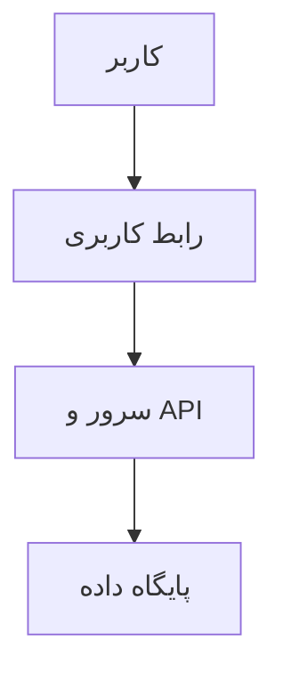

# تبسم وثاق ساعت 13:30 درس مباحث ویژه برنامه نویسی

# فعالیت فصل 3
## سیستم مدیریت وظایف

## ۱. منابع پروژه (Resources)
این پروژه شامل دو منبع اصلی است:
- کاربران (Users): نگهداری اطلاعات کاربران سیستم.
- وظایف (Tasks): نگهداری اطلاعات وظایف هر کاربر.

## ۲. آدرس‌های مربوط به کاربران(Users Endpoints)
| آدرس | متد | کد وضعیت |
|---|---|---|
| /users | GET | 200 |
| /users | POST | 201 |
| /users/{id} | PUT | 200 |
| /users/{id} | DELETE | 204 |

## ۳. آدرس‌های مربوط به وظایف (Tasks Endpoints)
| آدرس | متد | کد وضعیت |
|---|---|---|
| /tasks | GET | 200 |
| /tasks | POST | 201 |
| /tasks/{id} | GET | 200 |
| /tasks/{id} | PUT | 200 |
| /tasks/{id} | DELETE | 204 |
## ۴. دیاگرام معماری (Architecture Diagram)

#فعالیت فصل 4
## Digital Wallet – Dockerized Backend

## معرفی پروژه

در این پروژه یک بک‌اند ساده برای سیستم کیف پول دیجیتال (Digital Wallet) با زبان Python و فریم‌ورک Flask پیاده‌سازی شده است.

این سیستم امکاناتی مثل ثبت‌نام کاربران، ورود به حساب، مشاهده موجودی کیف پول، واریز وجه و انتقال پول بین کاربران را فراهم می‌کند.

برای اجرای برنامه از Docker استفاده شده تا بک‌اند داخل یک Container اجرا شود.

## ابزارهای استفاده‌شده

- Python
- Flask
- SQLite
- Docker
- GitHub Codespaces

## ساختار فایل‌های پروژه

- `app/app.py` : کد اصلی بک‌اند و تعریف APIها
- `requirements.txt` : کتابخانه‌های موردنیاز پروژه
- `Dockerfile` : دستورالعمل ساخت Docker Image
- `.dockerignore` : مشخص کردن فایل‌هایی که نباید وارد Image شوند
- `README.md` : توضیحات پروژه

## ساخت Docker Image

برای ساخت Image از دستور زیر استفاده شده است:

```bash
docker build -t digital-wallet .
```

در این مرحله Docker با استفاده از Dockerfile، محیط اجرای Python را آماده کرده و کتابخانه‌های موردنیاز و فایل‌های بک‌اند را داخل Image قرار می‌دهد.

## اجرای Container

پس از ساخت Image، با دستور زیر Container اجرا می‌شود:

```bash
docker run -d -p 5000:5000 --name wallet-container digital-wallet
```

در این دستور:
- `digital-wallet` نام Image است.
- `wallet-container` نام Container است.
- `-d` باعث اجرای برنامه در پس‌زمینه می‌شود.
- `-p 5000:5000` پورت سیستم را به پورت داخل Container متصل می‌کند.

## بررسی وضعیت Container

برای مشاهده Containerهای در حال اجرا از دستور زیر استفاده می‌شود:

```bash
docker ps
```

## اتصال پورت‌ها (Port Mapping)

پورت 5000 در محیط Codespaces به پورت 5000 داخل Container متصل شده است. این اتصال باعث می‌شود بتوان از طریق مرورگر به API دسترسی داشت.

## تست بک‌اند

برای بررسی اجرای صحیح برنامه، آدرس اصلی API را در مرورگر باز می‌کنیم.

پاسخ دریافت‌شده:

```json
{
  "message": "Digital Wallet API is running"
}
```

## نتیجه نهایی

در این پروژه Docker Image با موفقیت ساخته شد و بک‌اند داخل یک Container اجرا شد. همچنین اتصال پورت 5000 برقرار شد و امکان دسترسی به API از طریق مرورگر فراهم شد.
